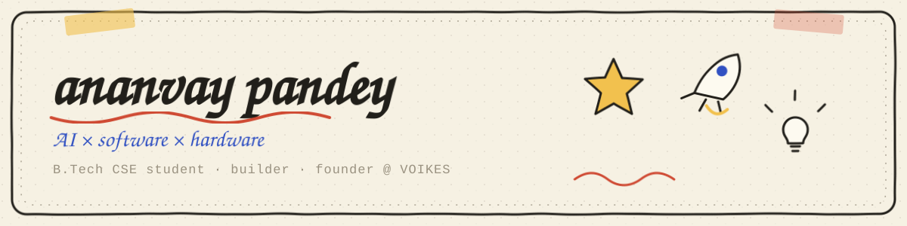
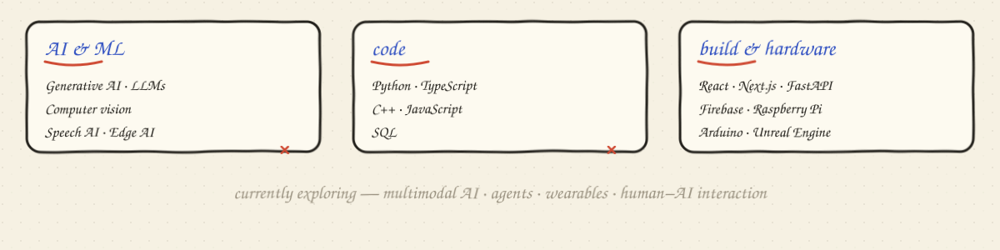
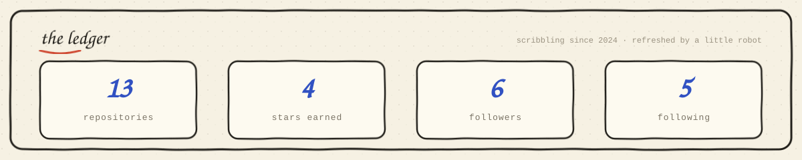
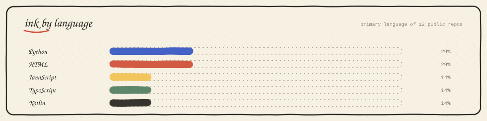
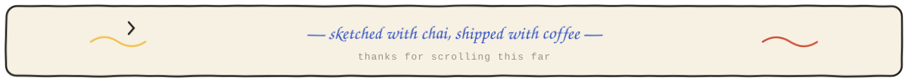

  

  
  
  
  

### ✏️ a quick sketch of me

I'm **Ananvay Pandey** — a B.Tech CSE student and builder working where **AI, software, and hardware** meet. I like taking an idea from a doodle on paper to something people can actually touch, talk to, or wear.

- 🔭 building **VOIKES Technologies** and shipping AI that feels less like a chatbot and more like a companion
- 🧠 exploring **edge AI, multimodal models, wearables, and human–AI interaction**
- 🔧 happiest with a Raspberry Pi in one hand and a half-finished notebook in the other
- 🎮 sometimes I ship browser games instead of sleeping

> "I don't just want to understand how technology works. I want to build what it can become."

---

### 🧰 the toolbox

  

---

### 🚀 things I've sketched into existence

| project | the one-liner | built with |
| :-- | :-- | :-- |
| **[VOKA](https://github.com/ananvaypandey/VOKA)** | an AI companion for mental well-being — lifelike avatar + hardware sensing | Raspberry Pi 5 · Unreal · MetaHuman · FastAPI |
| **[VOXLENS](https://github.com/ananvaypandey/VOXLENS)** | smart glasses that caption speech in real time | speech-to-text · embedded systems · HCI |
| **[VOSIGN](https://github.com/ananvaypandey/VOSIGN)** | a smart glove that turns sign language into speech | flex sensors · gesture recognition |
| **[VOZO](https://play.google.com/store/apps/details?id=com.aistudio.vozo.kdnoqm)** | offline peer-to-peer messenger — no internet, no SIM, no server | Android · Nearby Connections · on Google Play |
| **[VIONEX](https://play.google.com/store/apps/details?id=com.VoikesTechnologies.Vionex)** | a 2.5D platformer with a pixel hero and a loyal pet fox — fully offline | 2.5D art · game dev · on Google Play |

…plus a hand-drawn endless runner and a shelf of experiments that may or may not compile.

---

### 📱 shipped to the Play Store

apps published under **VOIKES Technologies** — [developer profile](https://play.google.com/store/apps/developer?id=VOIKES+TECHNOLOGIES+PRIVATE+LIMITED)

  
  

---

### 🌱 right now

- **building** — VOKA and the VOIKES stack
- **learning** — multimodal AI, edge inference, real-time robotics
- **open to** — collabs on AI × hardware, accessibility tech, and strange interfaces
- **ask me about** — Raspberry Pi builds, MetaHuman, turning demos into products

### 🗒️ field notes

- [x] shipped VOKA, VOXLENS, VOSIGN & VOZO
- [x] built a paper-sketch game just for fun
- [ ] something with robots that probably shouldn't exist yet
- [ ] collect more notebooks than free time

---

### 🎮 take a five-minute break

**Paper Runner** — a little hand-sketched endless runner

---

### 📈 leftover graphite

  
  

cards are generated straight from the GitHub API by a tiny daily Action — no third-party service to go down.

---

### 📫 find me in the margins

  
  
  

  

